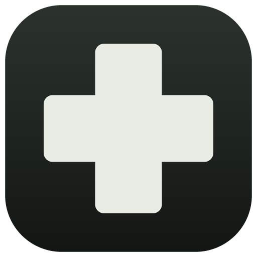
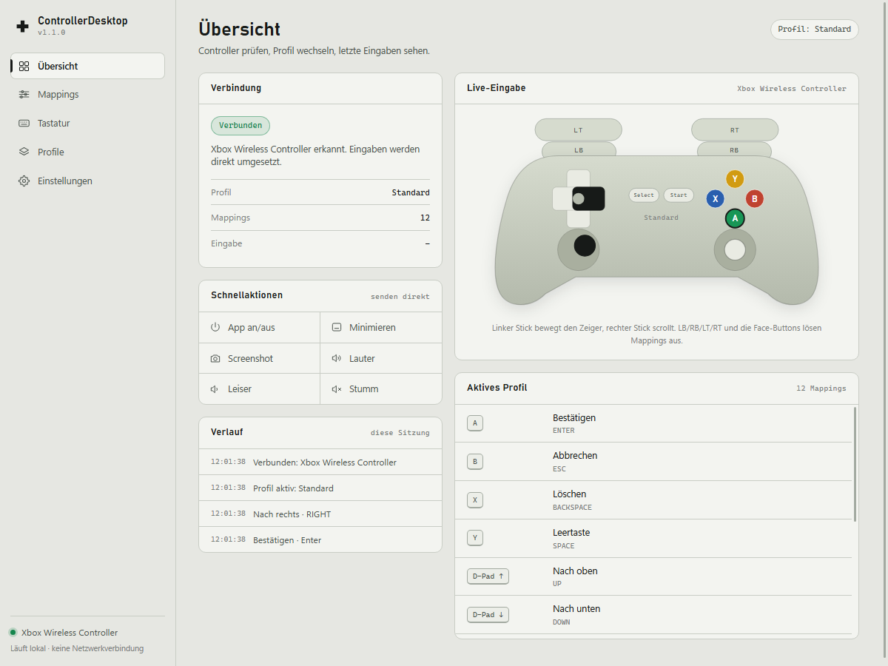
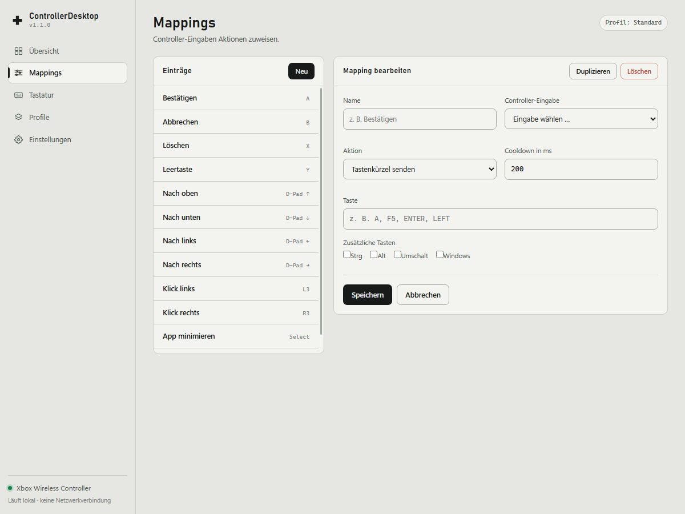
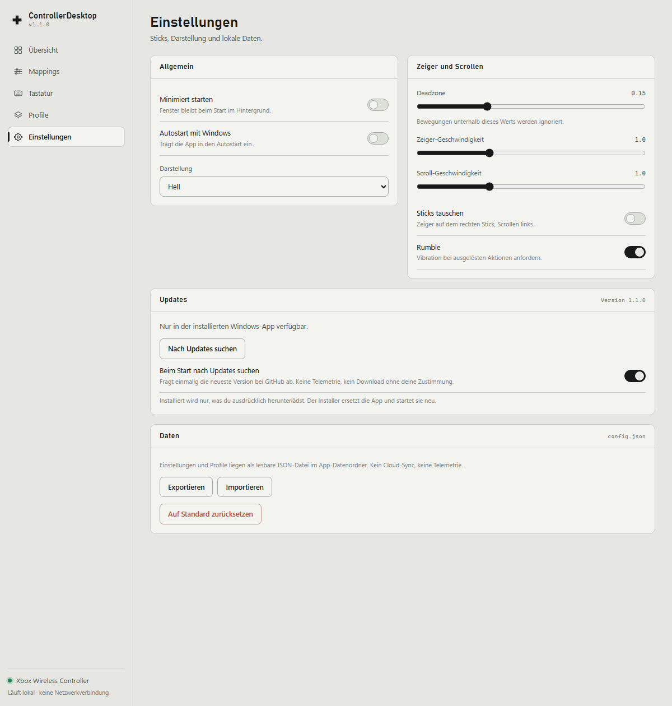
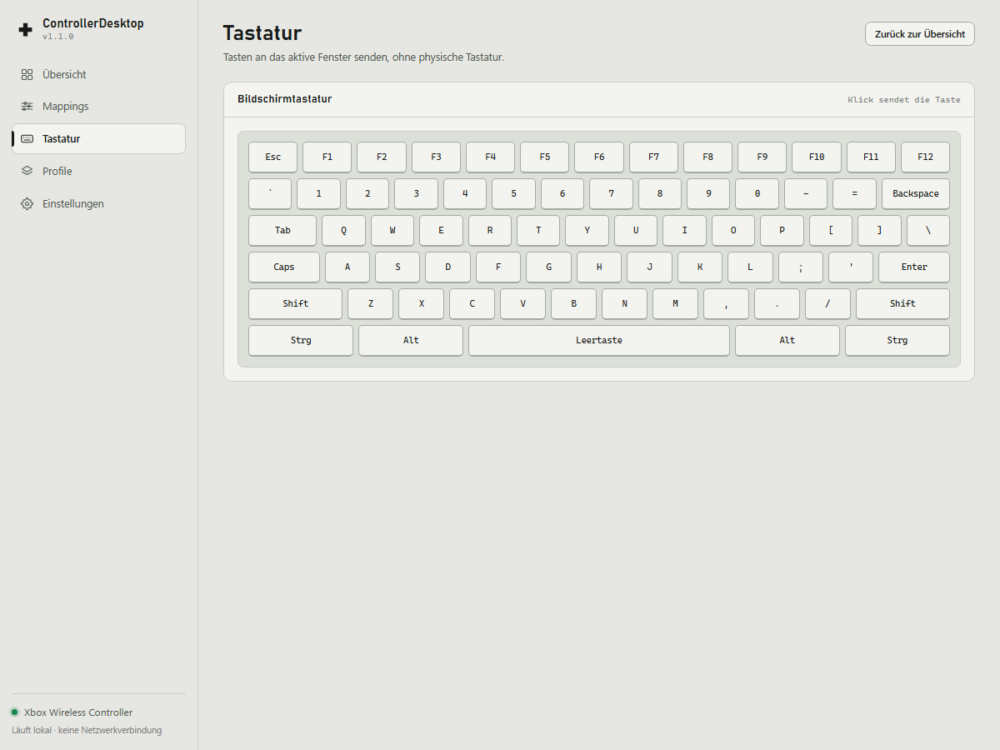
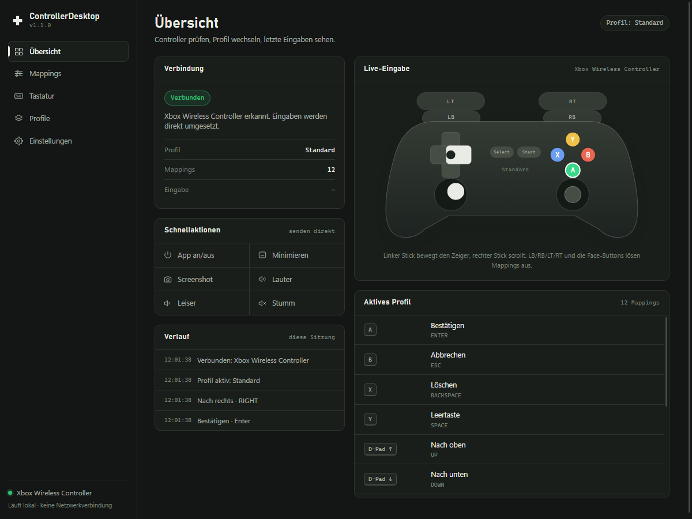

<p align="center">
  
</p>

<h1 align="center">ControllerDesktop</h1>

<p align="center">
  Controller als Maus und Tastatur für Windows – portabel, lokal, ohne Konto.
</p>

<p align="center">
  <b>Deutsch</b> · <a href="README.md">English</a>
</p>

<p align="center">
  Windows 10/11 · Electron · keine Telemetrie · MIT
</p>



## Was die App macht

ControllerDesktop liest den Controller über die Gamepad-API des Browsers und injiziert Maus- und Tastatureingaben systemweit. Damit lässt sich Windows vom Sofa aus bedienen, ohne physische Tastatur.

- **Zeiger und Scrollen** – linker Stick bewegt den Cursor, rechter Stick scrollt, mit Deadzone-Kennlinie und einstellbarer Geschwindigkeit
- **Mappings** – jede Eingabe (Buttons, D-Pad, Stick-Achsen) auf Tastenkürzel, Mausklicks, Scrollen, Makros oder App-Befehle legen
- **Profile** – getrennte Belegungen, im Betrieb umschaltbar
- **Bildschirmtastatur** – Tasten an das aktive Fenster senden
- **Live-Ansicht** – gedrückte Buttons, Stickpositionen und aktives Profil in Echtzeit
- **Deutsch und Englisch** – in den Einstellungen umschaltbar, folgt standardmäßig der Systemsprache
- **Tray** – läuft im Hintergrund, zeigt den Verbindungsstatus und pausiert Eingaben sofort
- **Standardmäßig lokal** – Einstellungen und Profile in einer lesbaren `config.json`, keine Cloud, keine Analytics

## Screenshots

| Mappings | Einstellungen und Updates |
| --- | --- |
|  |  |

| Bildschirmtastatur | Dunkles Theme |
| --- | --- |
|  |  |

## Installation

**Installer (empfohlen, updates-fähig)**

1. `ControllerDesktop-Setup-<version>.exe` aus den Releases herunterladen
2. Ausführen, Zielordner wählen, fertig
3. Start über Startmenü, Desktop-Verknüpfung oder Autostart (Einstellungen)

Der Installer installiert pro Benutzer (keine Adminrechte) nach `%LOCALAPPDATA%\Programs\ControllerDesktop`. Nur diese Variante aktualisiert sich selbst.

**Portable**

`ControllerDesktop-Portable-<version>.exe` ist eine einzelne Datei ohne Installation, läuft von USB-Stick oder beliebigem Ordner. Sie prüft nach Updates, kann sich aber nicht selbst ersetzen – dafür die neue EXE herunterladen.

## Updates

Die App nutzt `electron-updater` mit den GitHub-Releases dieses Repositories.

- Beim Start wird einmalig die neueste Version abgefragt (abschaltbar unter Einstellungen → Updates).
- **Kein Download ohne Zustimmung:** erst „Update herunterladen" lädt im Hintergrund, mit Fortschrittsbalken.
- **Installation** auf „Neu starten und installieren" oder beim nächsten normalen Beenden.
- Übertragen werden nur Versionsinformation und das Update-Paket – keine Telemetrie.
- Im Entwicklungsmodus und unter Linux ist der Prüfer deaktiviert und meldet das.
- Portable-Builds zeigen die neue Version an, verweisen aber auf den Download im Release statt selbst zu installieren.

**Release veröffentlichen** (Voraussetzung, damit Updates ankommen):

```bash
# GitHub-Token mit repo-Rechte als Umgebungsvariable
setx GH_TOKEN ghp_...
npm run publish
```

Alternativ einen Tag passend zur `package.json` pushen (`v1.1.0`): [`release.yml`](../.github/workflows/release.yml) prüft Tag und Version, baut dann Installer, Portable-EXE, `latest.yml` und Blockmap auf `windows-latest` und veröffentlicht sie als Release.

Jeder Push auf `master`/`main` und jeder manuelle Lauf baut dieselben Dateien **ohne** Veröffentlichung; die Artefakte des Laufs enthalten Installer, Portable-EXE und `latest.yml`, sodass sich die Pipeline vor einem Release prüfen lässt.

## Standardbelegung

| Controller | Aktion |
| --- | --- |
| D-Pad | Pfeiltasten |
| A / Cross | Enter |
| B / Circle | Escape |
| X / Square | Backspace |
| Y / Triangle | Space |
| L3 | Maus links |
| R3 | Maus rechts |
| Linker Stick | Zeiger |
| Rechter Stick | Scrollen |
| Select / Back | App minimieren |
| Start / Options | App-Fenster an/aus |

LB, RB, LT und RT sind standardmäßig frei und lassen sich in der App belegen.

## Selbst bauen

```bash
npm install
npm run build            # Installer + Portable nach release/
npm run build:installer  # nur NSIS-Installer
npm run build:portable   # nur portable EXE
```

Voraussetzung ist Node 18+. Der Build läuft unter Windows; unter Linux braucht electron-builder zusätzlich Wine (`apt install wine64`).

## Projektstruktur

```
main.js                        Hauptprozess: Fenster, Tray, Config, Eingaben, Updates
preload.js                     IPC-Brücke (contextIsolation)
src/                           Renderer: index.html, styles.css, app.js, i18n.js
build/icon.png                 App-Icon (Quelle für electron-builder)
build/installer.nsh            NSIS-Anpassungen (App vor Update beenden, Registry)
electron-builder.yml           Installer-, Portable- und Publish-Konfiguration
create-icons.js                erzeugt Icons ohne externe Abhängigkeiten
docs/screenshots/              Screenshots für dieses README
../.github/workflows/release.yml  Windows-CI im Repo-Wurzelverzeichnis: Build bei Push, Release bei Tag
```

## Hinweise

- Windows SmartScreen kann beim ersten Start einer unsignierten EXE warnen („Weitere Informationen" → „Trotzdem ausführen"). Ein Code-Signing-Zertifikat ist nicht hinterlegt.
- nut-js verwendet das US-Tastaturlayout; auf deutschem Layout weichen einige Sonderzeichen ab.
- Es wird nur der Standard-Gamepad-Stack von Windows genutzt (XInput/DirectInput), keine Treiberinstallation.
