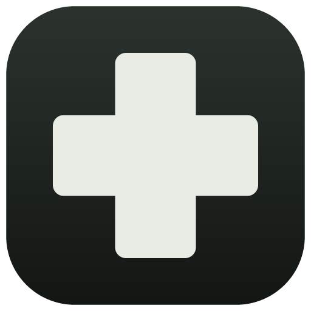
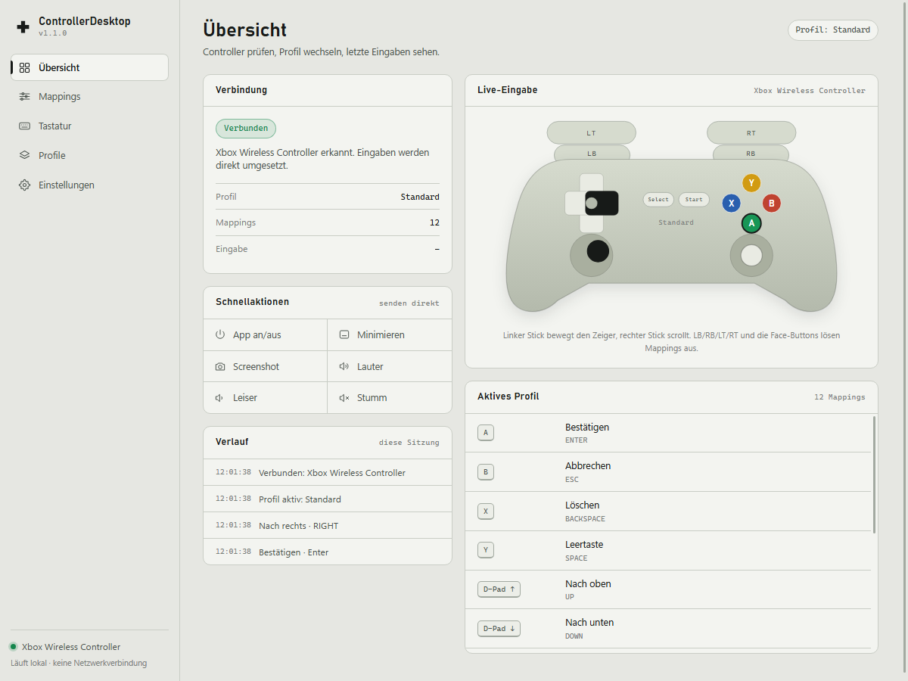
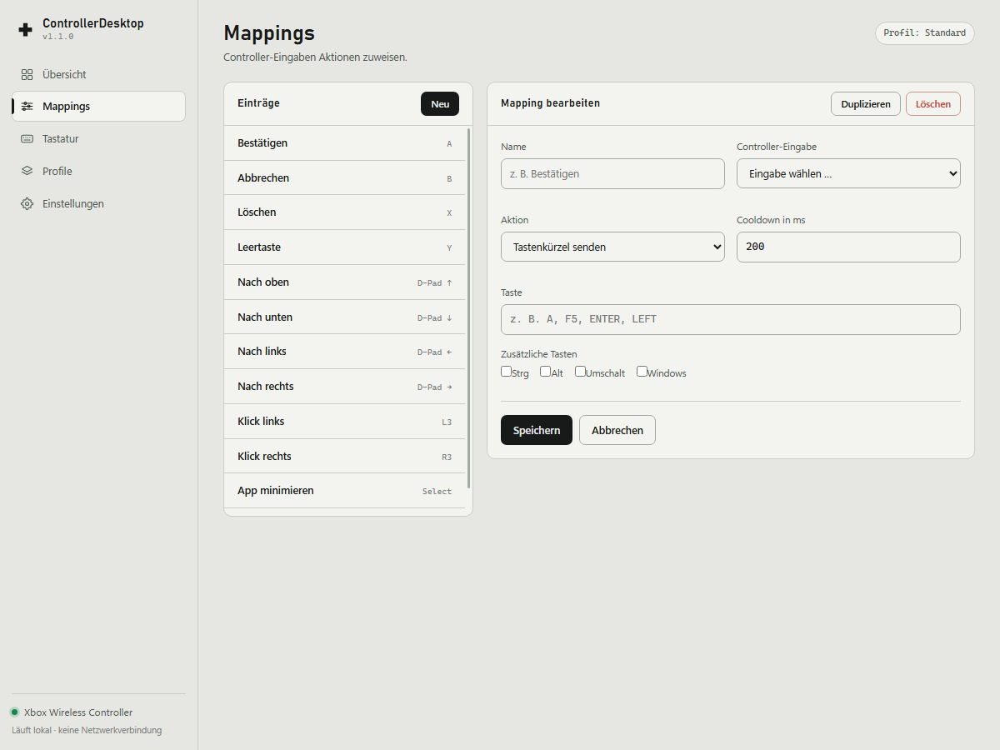
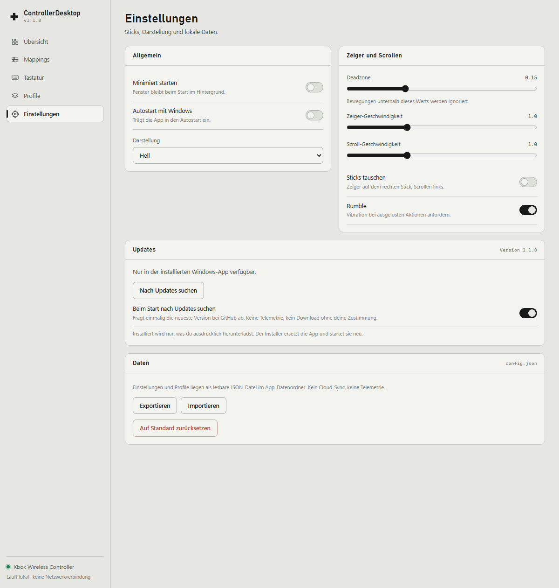
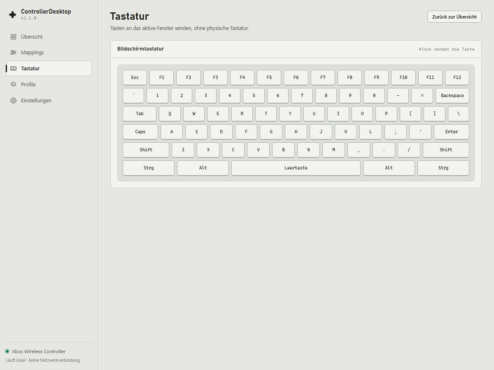
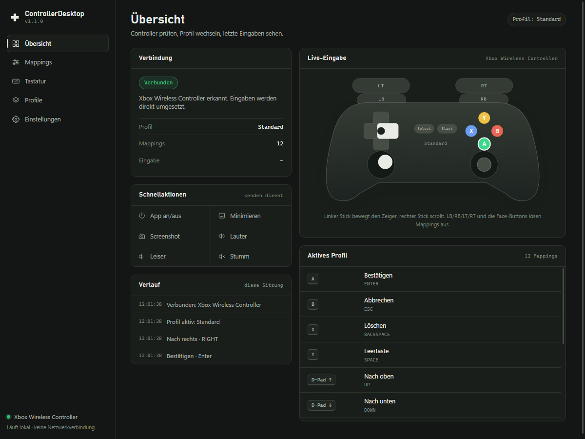

<p align="center">
  
</p>

<h1 align="center">ControllerDesktop</h1>

<p align="center">
  Turn a gamepad into a mouse and keyboard for Windows – portable, local, no account.
</p>

<p align="center">
  <b>English</b> · <a href="README.de.md">Deutsch</a>
</p>

<p align="center">
  Windows 10/11 · Electron · no telemetry · MIT
</p>



## What it does

ControllerDesktop reads a controller through the browser Gamepad API and injects mouse and keyboard input system-wide, so you can drive Windows from the couch without touching a keyboard.

- **Pointer and scrolling** – left stick moves the cursor, right stick scrolls, both with deadzone curve and adjustable speed
- **Mappings** – assign any controller input (buttons, D-pad, stick axes) to shortcuts, mouse clicks, scrolling, macros or app commands
- **Profiles** – separate mapping sets, switchable at runtime
- **On-screen keyboard** – send keystrokes to the focused window
- **Live view** – the dashboard shows pressed buttons, stick positions and the active profile in real time
- **German and English UI** – switchable in Settings, follows the system language by default
- **Tray** – runs in the background, shows connection state, can pause input immediately
- **Local by default** – settings and profiles in a plain `config.json`, no cloud, no analytics

## Screenshots

| Mappings | Settings & updates |
| --- | --- |
|  |  |

| On-screen keyboard | Dark theme |
| --- | --- |
|  |  |

## Install

**Installer (recommended, self-updating)**

1. Download `ControllerDesktop-Setup-<version>.exe` from Releases
2. Run it, choose a folder, done
3. Launch from the Start menu or the desktop shortcut; autostart is available in Settings

The installer is per-user (no admin rights) and installs to `%LOCALAPPDATA%\Programs\ControllerDesktop`. Only this variant can update itself.

**Portable**

`ControllerDesktop-Portable-<version>.exe` is a single file that runs from a USB stick or any folder without installation. It can check for updates but cannot replace itself – download the new EXE instead.

## Updates

The app ships with `electron-updater` pointed at the GitHub Releases of this repository.

- On start it asks GitHub once for the latest version (toggle in Settings → Updates).
- **No download without consent**: the update is fetched only when you click "Update herunterladen", with a progress bar.
- **Install** happens on "Neu starten und installieren" or the next normal quit.
- Only version metadata and the update package are transferred – no telemetry.
- In development mode and on Linux the checker is disabled and says so.
- Portable builds show the new version but point to the release download instead of installing.

**Publishing a release** (needed before updates can arrive):

```bash
# GitHub token with repo scope as environment variable
setx GH_TOKEN ghp_...
npm run publish
```

Or push a tag that matches `package.json` (`v1.1.0`): [`release.yml`](../.github/workflows/release.yml) verifies the tag against the version, then builds the installer, portable EXE, `latest.yml` and blockmap on `windows-latest` and publishes them as a release.

Every push to `master`/`main` and every manual run builds the same files **without** publishing them; the run's artifacts contain installer, portable EXE and `latest.yml`, so the pipeline can be checked before a release.

## Default mapping

| Controller | Action |
| --- | --- |
| D-Pad | Arrow keys |
| A / Cross | Enter |
| B / Circle | Escape |
| X / Square | Backspace |
| Y / Triangle | Space |
| L3 | Left click |
| R3 | Right click |
| Left stick | Pointer |
| Right stick | Scroll |
| Select / Back | Minimize app |
| Start / Options | Toggle app window |

LB, RB, LT and RT are free by default and can be mapped in the app.

## Build

```bash
npm install
npm run build            # installer + portable into release/
npm run build:installer  # NSIS installer only
npm run build:portable   # portable EXE only
```

Requires Node 18+. Build on Windows; on Linux electron-builder additionally needs Wine (`apt install wine64`).

## Project structure

```
main.js                        main process: window, tray, config, input, updates
preload.js                     IPC bridge (contextIsolation)
src/                           renderer: index.html, styles.css, app.js, i18n.js
build/icon.png                 app icon (source for electron-builder)
build/installer.nsh            NSIS tweaks (stop app before update, registry)
electron-builder.yml           installer, portable and publish configuration
create-icons.js                generates icons without dependencies
docs/screenshots/              screenshots used in this README
../.github/workflows/release.yml  Windows CI at the repository root: build on push, release on tag
```

## Notes

- The interface is available in German and English (Settings → Language). It follows the system language by default; the screenshots show the German UI.
- Windows SmartScreen may warn on first launch of an unsigned EXE ("More info" → "Run anyway"). No code-signing certificate is bundled.
- nut-js uses the US keyboard layout; a few punctuation keys differ on a German layout.
- Requires the standard Windows gamepad stack (XInput/DirectInput), no drivers.
